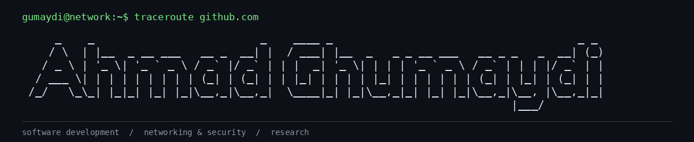

**Ahmad Ghumaydi** is a technology enthusiast based in **South Sumatra, Indonesia**, focused on practical computer networking, software development, and applied research. He is the founder of **[Xiao Systems](https://xiaosystems.id)** and serves as **Commander of [Bina Darma Cyber Army (BDCA)](https://github.com/bidarcyberarmy)** for the 2026/2027 term.

**Bahasa Indonesia:** [Baca profil dalam Bahasa Indonesia](README.id.md).

## About Me

- I work with **network infrastructure and wireless connectivity**, from device discovery and traffic analysis to practical network troubleshooting.
- I enjoy building software prototypes and technical solutions, including **AI-assisted development**. I care about understanding, testing, and documenting the results, not collecting language badges.
- I'm interested in **network security** and gradually expanding my work into **research and reproducible technical experiments**.
- I help lead a student technology community, with an emphasis on collaboration, technical learning, and building useful projects.

## Networking & Infrastructure

I work with networking equipment and tools in real-world environments. My experience includes using **Wireshark**, **Angry IP Scanner**, and IP scanning utilities, as well as working with devices in the **MikroTik, Cisco, TP-Link, and Ruijie** ecosystems.

One of my practical projects involves network optimization at **Kost Bahagia**, covering **12 access points and 1 router**, with a focus on improving Wi-Fi coverage and the experience of moving between access points. A dedicated public repository and technical case study will be added when the documentation is ready.

Current areas of interest: **wireless networking · network visibility · troubleshooting · network automation · infrastructure security**.

## Professional Experience

My background includes vocational training in **Computer Networking and Telecommunications** and practical IT support experience at **Universitas Muhammadiyah Palembang (June 2023–January 2024)**, working on network infrastructure installation, maintenance, troubleshooting, and hardware/software support.

I'm currently studying **Informatics Engineering at Universitas Bina Darma**.

## Software Development & Open Source

I use software and AI-assisted workflows to explore ideas, prototype solutions, and solve practical problems. My goal is to share useful, understandable repositories with clear installation instructions, technical decisions, and reproducible examples.

Public projects will be linked here as their source code and documentation are ready. I prefer a small number of maintained repositories over a large collection of unfinished demos.

## Research & Technical Writing

I'm developing an interest in **applied research**, especially in networking, infrastructure, and practical technology. Future research repositories will aim to include the problem statement, methodology, code or configurations where appropriate, measurements, limitations, and references.

My technical notes and learning materials are available on [GitBook](https://xiao-caomay.gitbook.io). Research papers and formal publications will be listed after they exist.

## Community & Leadership

- **Founder, [Xiao Systems](https://xiaosystems.id)** — developing a technology-focused initiative and its practical work.
- **Commander, [Bina Darma Cyber Army (BDCA)](https://github.com/bidarcyberarmy)** (2026/2027) — helping lead a student cybersecurity and IT community at Universitas Bina Darma, Palembang. [Website](https://bidarcyberarmy.org).

## Tools & Technologies

A focused view of the networking equipment, applications, and technical practices I have experience with. Brand names indicate **hands-on exposure**, not vendor certification.

### Network Analysis & Discovery

  
  

### Network Hardware & Platforms

  
  
  
  

**Hardware exposure:** routers, wireless access points, and network infrastructure installation.

### Network Engineering & Operations

  
  
  
  
  
  
  

These labels summarize practical experience and training, not a claim of mastery of every subject.

### Development, Documentation & Collaboration

  
  
  

Programming languages and additional software platforms will be listed as relevant public projects are documented.

## Connect

[**Personal Website**](https://ghumaydi.my.id) · [**Xiao Systems**](https://xiaosystems.id) · [**BDCA**](https://bidarcyberarmy.org) · [**LinkedIn**](https://www.linkedin.com/in/gumaydi/) · [**Instagram**](https://www.instagram.com/gumaydi) · [**GitBook**](https://xiao-caomay.gitbook.io)

---

*Non ducor, duco.*
